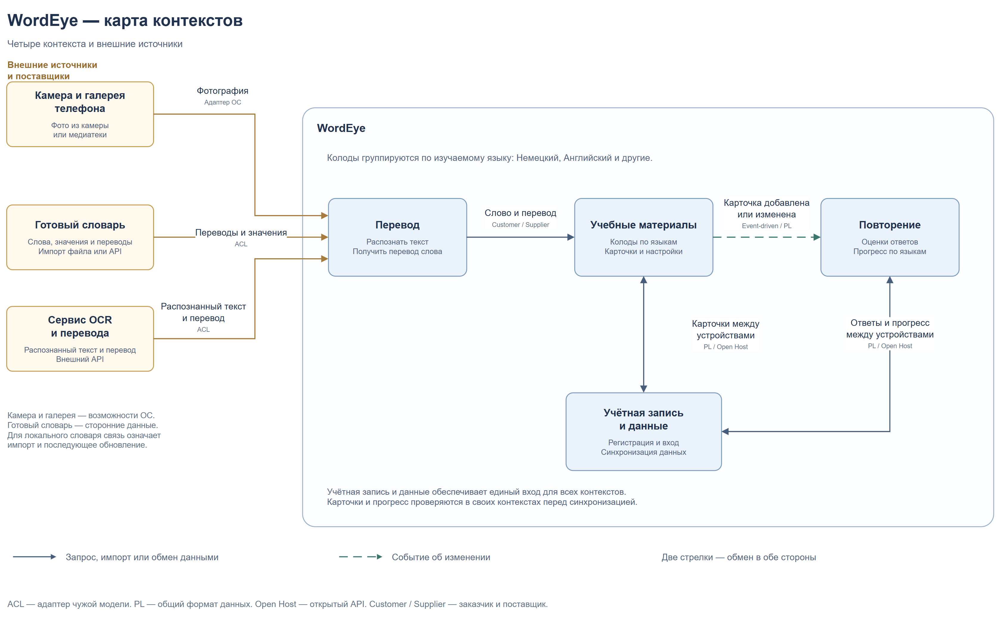

# Context Map

## О диаграммах

- **Цель** — [заполнить]
- **Что включено** — [заполнить]
- **Ключевые решения** — [заполнить]

## Версия 2

[Все 5 страниц в diagrams.net](https://viewer.diagrams.net/?pages=1&title=WordEye_Context_Map_v2.drawio#Uhttps%3A%2F%2Fraw.githubusercontent.com%2Fsatrly%2FWordeye%2Fmain%2Fdocs%2Farchitecture%2FWordEye_Context_Map_v2.drawio) · [Исходник .drawio](../WordEye_Context_Map_v2.drawio)

Версия 1

[Все 4 страницы в diagrams.net](https://viewer.diagrams.net/?pages=1&title=WordEye_Context_Map%20%281%29.drawio#Uhttps%3A%2F%2Fraw.githubusercontent.com%2Fsatrly%2FWordeye%2Fmain%2Fdocs%2Farchitecture%2FWordEye_Context_Map%2520%25281%2529.drawio) · [Исходник .drawio](../WordEye_Context_Map%20%281%29.drawio)

В diagrams.net страницы переключаются стрелками или через список внизу просмотрщика.
